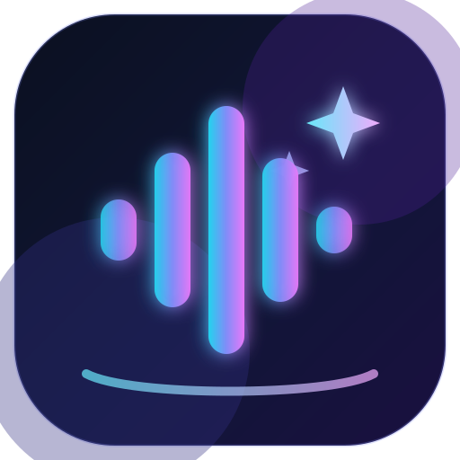
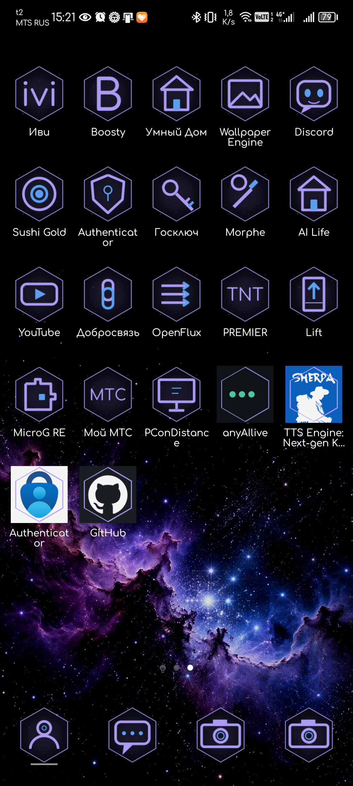
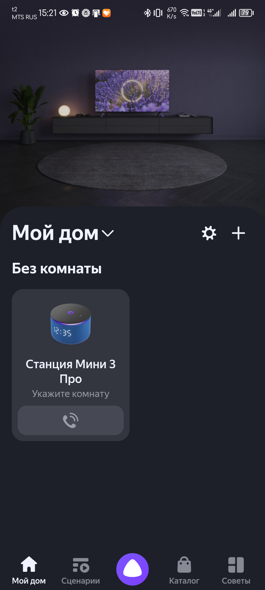
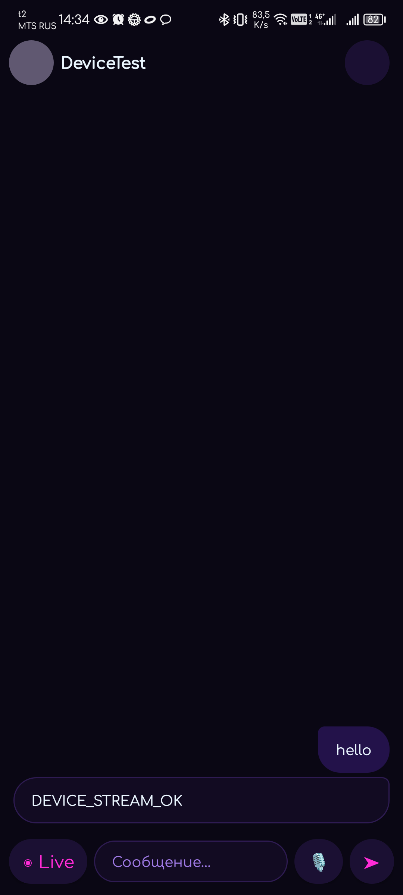

<div align="center">



# anyAIlive

**Голосовой AI-чат для Android в стиле Gemini Live**

Говори с любой моделью по OpenAI-совместимому API — со звуком, волнами и кнопкой Live.

[](https://github.com/alexfduch231-prog/anyailive/releases/latest)
[](#)
[](#)
[](LICENSE)
[](https://github.com/)

**[⬇️ Скачать последнюю версию APK](https://github.com/alexfduch231-prog/anyailive/releases/latest)**

</div>

---

## ✨ Что это

anyAIlive — лёгкий голосовой клиент (APK меньше 250 КБ!) для разговора с любым LLM-провайдером:

- 🔊 **Live-режим как в Gemini** — непрерывный голосовой диалог с анимированной волной, которая дрожит в такт речи (и твоей, и модели), субтитры над волной
- 🔌 **Любой провайдер** — OpenAI, DeepSeek, любой OpenAI-совместимый API: просто вписываешь base URL, ключ и имя модели
- 🎙 **Гибкий голос** — HTTP STT/TTS провайдера (whisper/tts) или полностью локальный офлайн-каскад (sherpa-ONNX / Piper)
- 🛑 **Бардж-ин** — перебивай модель голосом, она замолчит и слушает
- 🎨 **8 тем** — от «Тёмная (Gemini)» до Киберпанка и Матрицы
- 🌐 **RU / EN интерфейс** — переключается в настройках, применяется мгновенно
- 🔒 **Ключи хранятся в Android Keystore** (AES/GCM), история — локально, ничего не утекает
- 🪶 **Без Gradle и AndroidX** — чистый Java-проект, собирается скриптом за секунды

## 📱 Скриншоты

| Чат | Живой экран | Тема Киберпанк |
|---|---|---|
|  |  |  |

## ⬇️ Установка

1. Скачай [последний APK со страницы Releases](https://github.com/alexfduch231-prog/anyailive/releases/latest)
2. Разреши установку из неизвестных источников → установи
3. Добавь модель: **Модели → ➕** — имя, base URL (например `https://api.openai.com/v1`), ключ, модель
4. Пиши или жми 🎙. Для Live у модели включи тег **LIVE** (нужен провайдер с Realtime API) — либо используй режим Авто с HTTP STT/TTS

> Минимальный Android — 8.0 (API 26). Права: микрофон, уведомления.

## 🧩 Как устроено

```
app/src/ru/alexv/anyailive/
├── chat/     экран чата, история, политика приватности
├── voice/    каскад STT→LLM→TTS, Live-движок (OpenAI Realtime), волна
├── net/      HTTP/SSE/websocket-транспорт (nv-websocket-client)
├── data/     модели, настройки, шифрование ключей
└── tests/    ~290 JVM-тестов, гоняются на CI до сборки
```

Сборка без Gradle — нужен только JDK 17 и Android SDK (build-tools 34):

```powershell
powershell -File build.ps1   # тесты + APK
```

## 📄 Лицензии

- Код — [MIT](LICENSE)
- Названия моделей и провайдеров принадлежат их владельцам
- При локальном каскаде веса голосовых моделей (sherpa/Piper) скачиваются отдельно и имеют свои лицензии

<div align="center">
<sub>powered by dsh</sub>
</div>
